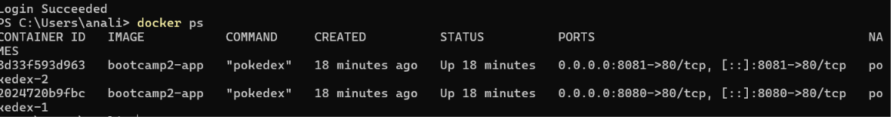

# Pokédex — Monte seu Time

## Autor
Samuel Maciel Fonseca — Matrícula 22506931

## Links
1. **Repositório GitHub:** https://github.com/samuelmfonseca/pokedex
2. **Aplicação no GitHub Pages:** https://samuelmfonseca.github.io/pokedex/
3. **Docker Hub:** https://hub.docker.com/r/samuelmacielfonseca/bootcamp2-app

## Rodar com um único comando
```bash
docker run -d -p 8080:80 samuelmacielfonseca/bootcamp2-app:1.1
```
Abra **http://localhost:8080**. Para o banco sobreviver também à remoção do container, use um volume:
```bash
docker run -d -p 8080:80 -v pokedex-data:/app/data samuelmacielfonseca/bootcamp2-app:1.1
```

## Descrição
Aplicação web que busca e exibe Pokémon utilizando a PokeAPI e permite **montar e salvar um time de até 6 Pokémon**. O frontend é HTML + CSS + JavaScript puro; o backend próprio é escrito em **Rust com Axum** e persiste o time em um banco **SQLite**.

## Persistência de dados (Etapa 02)
- **Banco escolhido:** SQLite arquivo `data/pokedex.db`; no container, `/app/data/pokedex.db`, acessado pela crate `rusqlite`. É um banco SQL real em disco: o time continua lá depois de fechar o navegador, recarregar a página ou reiniciar o servidor.
- **Backend:** Rust + Axum (`src/main.rs`), que serve o frontend e a API REST.
- **O que é salvo:** cada Pokémon adicionado ao time, com seu apelido opcional.

### Estrutura da tabela `team`
| Coluna       | Tipo    | Descrição                                   |
|--------------|---------|---------------------------------------------|
| `id`         | INTEGER | Chave primária (autoincremento)             |
| `pokemon_id` | INTEGER | Número do Pokémon na Pokédex (PokeAPI)      |
| `name`       | TEXT    | Nome do Pokémon                             |
| `nickname`   | TEXT    | Apelido dado pelo treinador (opcional)      |
| `types`      | TEXT    | Tipos em JSON, ex.: `["fire","flying"]`     |
| `sprite`     | TEXT    | URL da imagem oficial                       |
| `position`   | INTEGER | Ordem do Pokémon no time (arrastar e soltar) |
| `created_at` | TEXT    | Data/hora em que entrou no time             |

### API REST
| Método   | Rota             | Operação                                   |
|----------|------------------|--------------------------------------------|
| `GET`    | `/api/team`      | **Read** — lista o time                    |
| `POST`   | `/api/team`      | **Create** — adiciona (máx. 6, sem repetir; senão 409) |
| `PATCH`  | `/api/team/{id}` | **Update** (bônus) — altera o apelido      |
| `PUT`    | `/api/team/order`| **Update** (bônus) — salva a nova ordem    |
| `DELETE` | `/api/team/{id}` | **Delete** — remove do time                |
| `GET`    | `/api/health`    | Health check                               |

### Na interface
- Seção **"Meu Time"** no topo, carregada do banco ao abrir a página, com 6 slots.
- Botão **"+ Adicionar ao time"** no modal de detalhes de cada Pokémon.
- **Arrastar e soltar:** arraste um card da Pokédex até o time para adicioná-lo (o time fica fixo no topo da tela durante o arraste) ou arraste os membros do time entre si para reordenar. A ordem é salva no banco.
- Cada Pokémon aparece em **um lugar só**: ao entrar no time, o card sai do grid; ao ser removido do time, o card volta ao grid. Por isso o time não aceita Pokémon repetidos (a API responde 409).
- Campo de **apelido** em cada membro (salva ao sair do campo ou apertar Enter).
- Botão **×** para remover o Pokémon do time.

### Limitações conhecidas
- Não há login: existe um único time compartilhado por todos que acessam o mesmo servidor.
- O arrastar e soltar usa a API nativa de *drag and drop* do HTML5, que não funciona em celulares/tablets com toque. Nesses aparelhos, use o botão "Adicionar ao time".
- A API aceita CORS de qualquer origem e não tem autenticação (aceitável nesta etapa).
- O **GitHub Pages** hospeda apenas arquivos estáticos e não roda o backend. A versão no Pages tenta usar um backend em `http://localhost:8080`; ou seja, o time funciona se o container estiver rodando na máquina de quem acessa.
- Sem volume (`-v`), o banco fica dentro do container: os dados sobrevivem a `docker stop`/`docker start`, mas se perdem com `docker rm`.

## API externa utilizada
- **Nome:** PokeAPI — https://pokeapi.co/docs/v2
- `GET /api/v2/pokemon/{id ou nome}`: nome, tipos, stats, habilidades, altura, peso e imagem
- `GET /api/v2/pokemon-species/{id}`: descrição, geração e cor

## Funcionalidades
- Busca por nome ou número (em tempo real, por Enter ou pelo botão)
- Filtros por geração (Gen 1 a 9)
- Cards com imagem oficial, nome, número e tipos
- Modal de detalhes com estatísticas, informações e habilidades
- Paginação com "Carregar mais Pokémon"
- **Time de Pokémon persistido no SQLite** (criar, listar, renomear, reordenar, excluir)
- **Arrastar e soltar** cards para montar e organizar o time
- Tratamento de erros, loading e design responsivo

## Como executar localmente (sem Docker)
Requer [Rust](https://rustup.rs) instalado.
```bash
git clone https://github.com/samuelmfonseca/pokedex
cd pokedex
cargo run
```
Acesse `http://localhost:3000`. Variáveis opcionais: `PORT` (padrão 3000), `DB_PATH` (padrão `data/pokedex.db`) e `STATIC_DIR` (padrão `.`).

## Docker (Parte B)
O `Dockerfile` é **multi-stage**: a primeira etapa (`rust:1-slim-bookworm`) compila o binário em modo release e a segunda (`debian:bookworm-slim`) leva só o binário e os arquivos do frontend. A imagem final tem ~120 MB, contra mais de 1 GB da imagem de build.

```bash
# Construir e testar
docker build -t bootcamp2-app .
docker run -d -p 8080:80 --name meu-app bootcamp2-app

# Publicar
docker login
docker tag bootcamp2-app samuelmacielfonseca/bootcamp2-app:1.0
docker push samuelmacielfonseca/bootcamp2-app:1.0
```

## Sidequests

### SQ1 · .dockerignore
O `.dockerignore` exclui `.git`, `target/` (build local do Rust, que pode passar de 1 GB), o banco local `data/`, o `README.md` e as imagens de evidência. Isso deixa o build mais rápido, porque o Docker envia ao daemon um *contexto* bem menor e não invalida o cache quando só a documentação muda. Também evita que arquivos desnecessários ou sensíveis (histórico git, banco com dados locais) acabem dentro da imagem.

### SQ2 · Versionamento de imagem
- `1.0`: primeira versão funcional (Pokédex + time salvo no SQLite: adicionar, listar, apelido e remover)
- `1.1`: melhoria com arrastar e soltar (cards da Pokédex → time, reordenação salva no banco) e cards que saem do grid ao entrar no time
- `latest`: aponta para a versão mais recente

```bash
docker tag bootcamp2-app samuelmacielfonseca/bootcamp2-app:1.1
docker tag bootcamp2-app samuelmacielfonseca/bootcamp2-app:latest
docker push samuelmacielfonseca/bootcamp2-app:1.1
docker push samuelmacielfonseca/bootcamp2-app:latest
```

### SQ3 · Descrição no Docker Hub
O *overview* do repositório no Docker Hub contém o que é a aplicação, o comando `docker run -d -p 8080:80 samuelmacielfonseca/bootcamp2-app:1.1` e o link para este repositório no GitHub.

### SQ4 · Explorando a orquestração
Dois containers rodando ao mesmo tempo, nas portas 8080 e 8081:
```bash
docker run -d -p 8080:80 --name pokedex-1 bootcamp2-app
docker run -d -p 8081:80 --name pokedex-2 bootcamp2-app
docker ps
```


**"Se eu tivesse 100 containers, como gerenciaria?"** Fazer isso à mão com `docker run` não escala: alguém teria que reiniciar containers que caem, distribuir os 100 entre várias máquinas, escolher portas e balancear o tráfego. É esse o trabalho de um orquestrador como o **Kubernetes**. Ele junta várias máquinas (*nodes*) em um **cluster** e trata esse conjunto como um único computador. A menor unidade que ele gerencia é o **pod**, que envolve um ou mais containers que compartilham rede e armazenamento. Em vez de comandos, eu descreveria o estado desejado em um *Deployment* ("quero 100 **réplicas** desta imagem") e o Kubernetes cuidaria de manter esse número: recria pods que falham, espalha as réplicas pelos nodes, faz atualizações graduais (*rolling update* de `1.0` para `1.1` sem derrubar o serviço) e coloca um *Service* na frente para balancear as requisições. Um detalhe importante para esta aplicação: com várias réplicas, o SQLite local de cada container deixaria de ser compartilhado, então o banco teria que virar um serviço separado (por exemplo, PostgreSQL).

## Estrutura do projeto
```
pokedex/
├── Cargo.toml      # Dependências Rust (axum, tokio, rusqlite, tower-http)
├── src/main.rs     # Backend Axum: API REST do time + servidor de arquivos
├── index.html      # Estrutura HTML (inclui a seção "Meu Time")
├── style.css       # Estilos responsivos e cores por tipo
├── script.js       # Frontend: PokeAPI, busca, filtros, modal e CRUD do time
├── Dockerfile      # Build multi-stage (Rust → Debian slim)
├── .dockerignore   # Arquivos fora da imagem
└── docs/           # Evidências das sidequests
```
